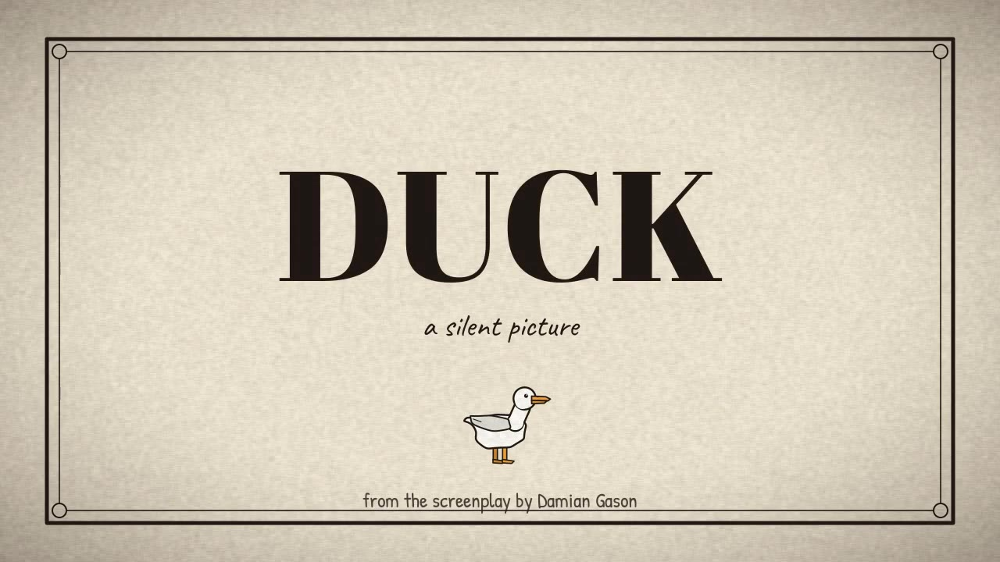
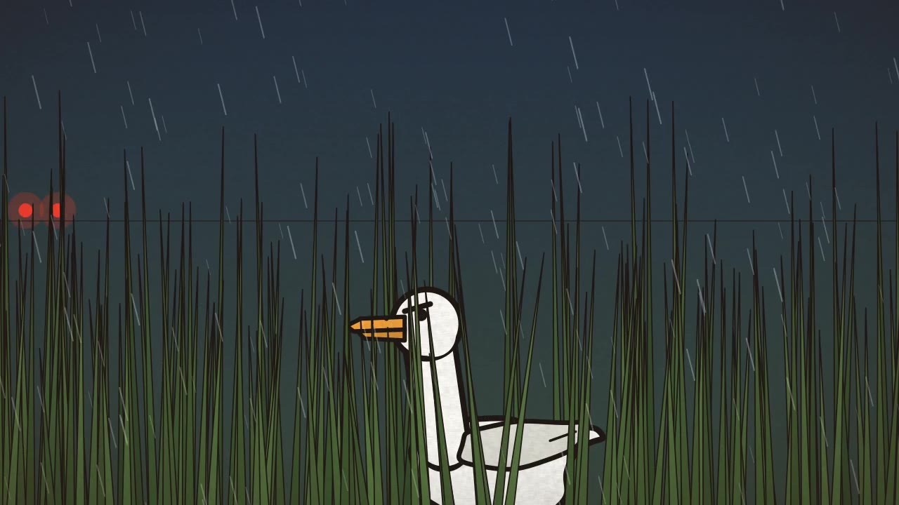
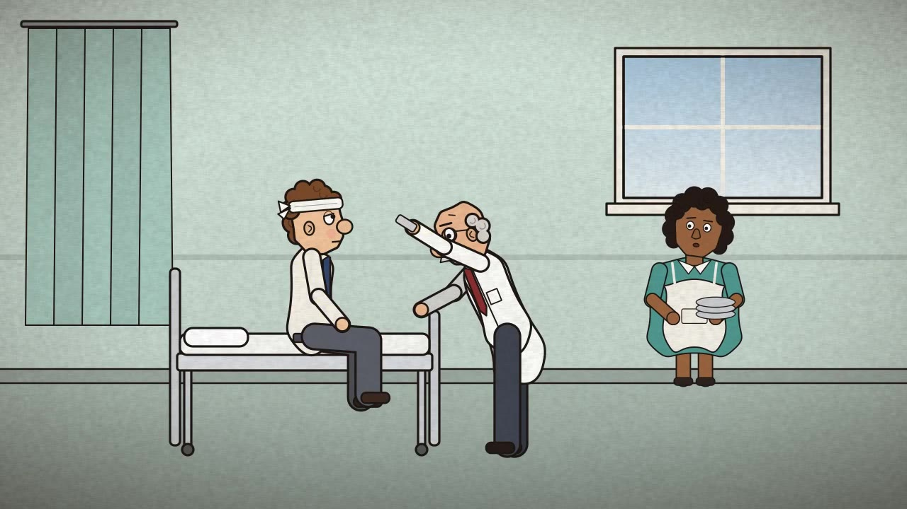
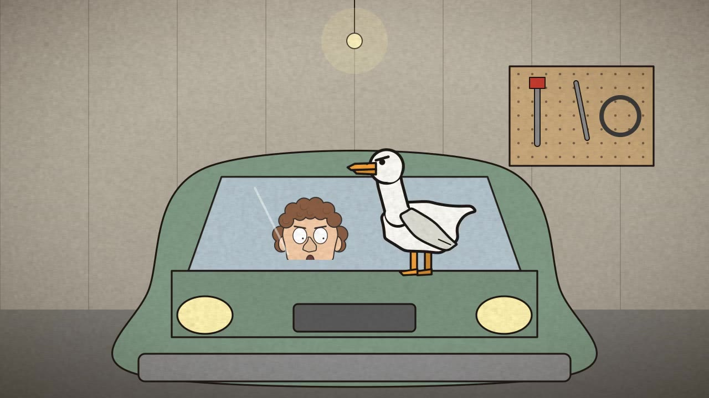
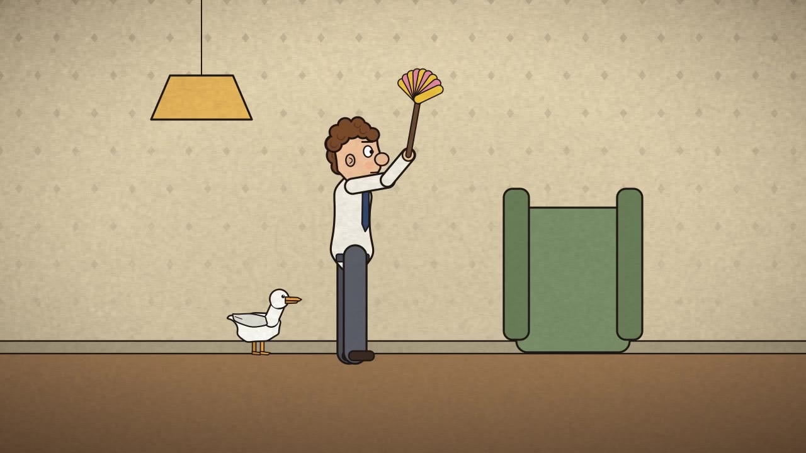
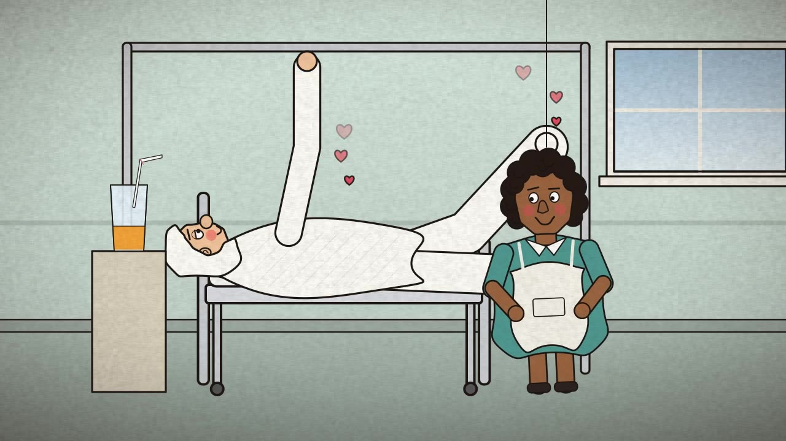
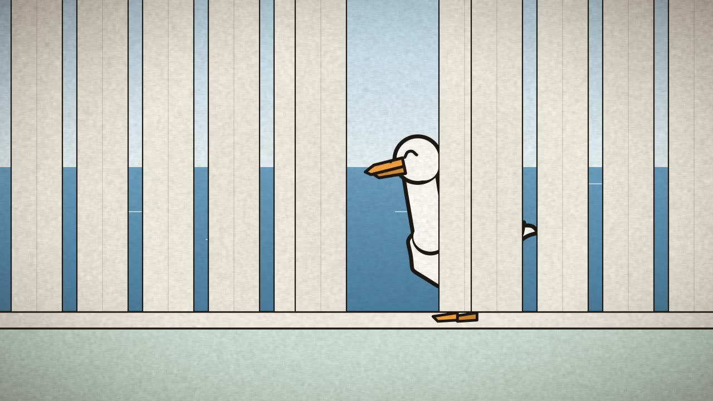

# DUCK: a silent picture

A 3½-minute silent 2D animated short, made from Damian Gason's screenplay *Duck* and the director's
pencil storyboards. Every frame is drawn by code.

**▶ Watch it: https://qmzpalgh.github.io/claude-duck/**

[](https://qmzpalgh.github.io/claude-duck/)

| | | |
|---|---|---|
|  |  |  |
|  |  |  |

## The approach

- **Silent, as the director intended.** There's no dialogue and no voiceover. The story is told through
  staging, inserts (the newspaper, the letter, the to-do list) and comic timing, under a code-synthesised
  score and sound effects.
- **Captain Pugwash-style economy.** The characters are articulated cut-out puppets with flat colours and bold
  ink outlines. Motion is limited, with limbs swinging on pivots, and held *on twos* (12 drawings a second
  on a 24 fps timeline).
- **No generative models.** Shapes, puppets, paper grain, music and sound are all procedural.

## Build it

```bash
pip install -r requirements.txt        # pycairo, numpy, scipy, pillow (plus ffmpeg on your PATH)
mkdir -p ~/.fonts && cp fonts/*.ttf ~/.fonts && fc-cache -f
python src/build.py                    # writes build/duck.mp4 (about a minute on 2 cores)
python src/build.py b13 c06            # re-render only shots whose names start with these
python src/stills.py act2 b13_crash:1.1 b15_hosp1:4   # contact sheet of chosen frames
```

## How the code is organised

| File | What's in it |
|---|---|
| `src/engine.py` | Cairo helpers (ink-outlined shapes, limbs, easing, keyframes), the paper overlay, and `Shot`, which renders one shot straight into ffmpeg, holding each drawing for two frames |
| `src/puppets.py` | Colin, the doctor, the cleaner, the duck and the fox: each is a function of a small pose dict |
| `src/props.py` | Shared sets and props: rain, cars, rooms, windows, clocks, the hospital bed, hearts and stars |
| `src/act1.py` … `act4.py` | One function per shot, plus each act's shot list with its timings and sound cues |
| `src/audio.py` | A tiny synthesiser (concertina reed, pizzicato, glockenspiel, bassoon), the score, the SFX and the mixer |
| `src/build.py` | Renders the shots in parallel, joins them with the ffmpeg concat demuxer, and muxes in the soundtrack |

The online preview is served by GitHub Pages from the `gh-pages` branch, which is a copy of `docs/`.
To republish after a re-render: copy `build/duck.mp4` into `docs/`, then push the contents of `docs/` to `gh-pages`.

A shot is just a duration plus a `draw(ctx, t)` function, so changing one moment of the film means editing
one function and re-rendering one shot.

## Credits

Story, screenplay and storyboards © Damian Gason. The animation code is under the Apache 2.0 licence (see
`LICENSE`). The fonts in `fonts/` (Abril Fatface, Caveat, Kalam, Patrick Hand) are under the SIL Open Font
License.
